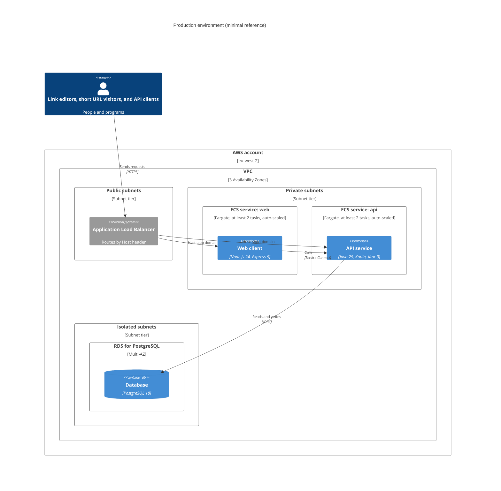

# Production hosting

- Authors: Kieran Potts [@kieranpotts]
- Created: 2026-10-19
- Decision date: —
- PR: —

## Status

PROPOSED

**Not in-scope for MVP.**

This ADR proposes a baseline AWS deployment, but it is not implemented. This
repository provisions no cloud infrastructure. The production design is worked
out here, rather than in the [physical view](../../design/physical/), which
describes only the local environment that this repository actually runs.

## Context

The hiring team asks for a high-level production architecture. This repository
doesn't provision any infrastructure.

The system is two stateless containers and one relational database. The
workload is read-heavy, latency-sensitive on redirects, and modest at first.
The operating team is assumed to be small, so managed services are preferred.

## Decision

The system will be deployed to AWS, in the London region (`eu-west-2`), across
three Availability Zones.

CloudFront and WAF sit at the edge, in front of one Application Load Balancer.
The API service and the web client run as ECS Fargate services in private subnets, on
RDS for PostgreSQL, Multi-AZ. Terraform defines the infrastructure.

Each service runs at least two tasks and auto-scales. The API service's management
port is reachable only inside the VPC.

### Deployment design

This is a minimal deployment design for production. It shows only the
infrastructure the system cannot run without. The edge (CloudFront, WAF, and
DNS), observability, secrets management, and the delivery pipeline are left out
of the diagram.

Two public hostnames are needed. The short domain (eg. `sho.rt`) serves the API
service. The app domain (eg. `app.sho.rt`) serves the web client.

The load balancer is the only component in the VPC with a public address. It
routes by `Host` header to the `web` or `api` service. Its health checks probe
the API service's management port.

The `web` and `api` images run as ECS Fargate services, with at least two tasks
each, spread across three Availability Zones. ECS auto-scales each service's
task count on CPU and requests per target. `web` calls `api` through ECS
Service Connect, inside the VPC.

The API service's management port, which serves liveness, readiness, and
metrics (see [ADR 0019](../0019/)), is reachable only from inside the VPC. The
load balancer forwards only the public port.

The database is RDS for PostgreSQL, with a synchronous standby in another
Availability Zone, automated backups, point-in-time recovery, and encryption at
rest. It sits in isolated subnets that have no route to the internet.

The same two images run locally and in production. Only environment variables
differ.

Sizing, network CIDRs, and IAM policies belong in the infrastructure repository
— out-of-scope for this repository.

## Consequences

- The team operates no servers, clusters, or databases directly.

- The system survives the loss of one Availability Zone without manual action.

- UK data stays in the UK.

- Fargate costs more per vCPU than EC2, but at this scale its simplicity is
  worth it. The design is AWS-specific at the edges, but the containers are
  portable.

- The API service owns the short domain's whole root path, so the web client needs a
  hostname of its own.

## Alternatives

- **Kubernetes (Amazon EKS).** Flexible and portable, but it brings a cluster to
  upgrade, secure, and operate, for two services.

- **AWS Lambda.** Free when idle, but JVM cold starts add latency to redirects,
  and Express needs an adapter.

- **Google Cloud Run, or Azure Container Apps.** Both are good fits, and
  arguably simpler, and the containers would move unchanged. AWS is the most
  widely used.

## Deferred decisions

Each of these is a scaling measure that adds moving parts. None is justified
until production metrics show a need. Start with random aliases
([ADR 0010](../0010/)) on a single PostgreSQL primary, then measure.

- **Redirect caching.** A cache-aside layer (eg. ElastiCache for Redis or
  Valkey) in front of the database, since redirects are over 90% of traffic.
  Revisit if redirect latency or database load breaches targets. It reverses
  [ADR 0012](../0012/), and would need Redis failure handling: replication, a
  circuit breaker, and a fallback to direct database reads, to avoid a
  thundering herd on the database.

- **Redirect status and browser caching.** Redirects are `302` so deletions
  take effect immediately. A later change could serve `301`, or a `302` with
  `Cache-Control`, for old links, trading control for lower load.

- **Distributed ID generation.** Snowflake-style or batch-allocated IDs, encoded
  as Base62, in place of random aliases. Revisit only if the collision rate or
  insert retries become measurable. This would make aliases sequential or
  time-sortable, which conflicts with the unpredictability requirement, so it
  would also need a specification change.

- **Global edge routing.** A CDN already fronts the system here, but
  multi-region deployment with geo-routing is a further step, if latency for
  distant users matters.

- **Database scaling.** Read replicas first, then sharding by alias, or a
  move to a horizontally scaled store such as DynamoDB. Sharding adds
  client-side routing and complicates cross-shard queries, such as `GET /urls`.
