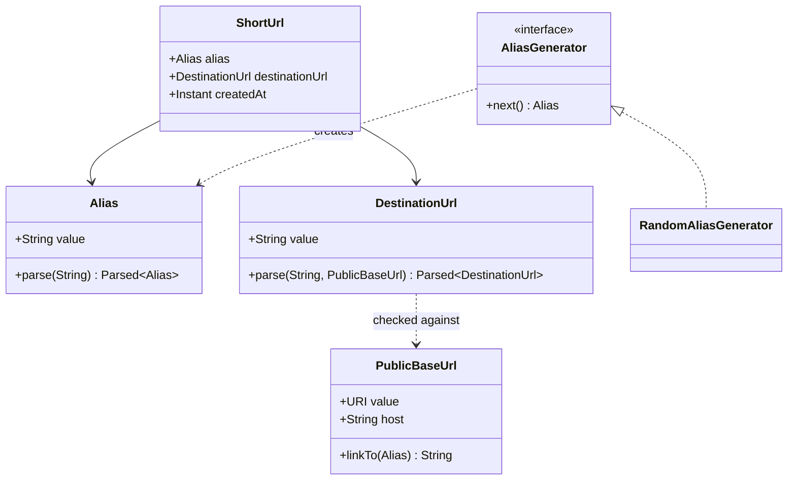

# Domain model

The domain is small. All of it lives in the API service's `domain` package. The
web client has no knowledge of the domain model (only of the OpenAPI contract).

The class diagram shows three kinds of relationship. Each is read from the tail
of the arrow (the source) to its head (the target). Optional labels describe the
relationships.

| Notation    | Name                   | Meaning                                                                        | Example                                             |
| ----------- | ---------------------- | ------------------------------------------------------------------------------ | --------------------------------------------------- |
| `A --> B`   | Association (directed) | A holds a reference to B, as a field. A knows about B. B doesn't know about A. | A `ShortUrl` has an `Alias` and a `DestinationUrl`. |
| `A ..> B`   | Dependency             | A uses B transiently, eg. as a parameter. It's a weaker, short-lived coupling. | `AliasGenerator` creates `Alias` values.            |
| `A <\|.. B` | Realization            | B implements the interface A.                                                  | `RandomAliasGenerator` implements `AliasGenerator`. |

Within a class box, `+` marks a public member, and `<<interface>>` marks a type
with no implementation of its own. `PK` marks the field that forms the entity's
key (here, `ShortUrl` is identified by its `alias`).

The domain objects capture all the logic for implementing the business rules.
The rules themselves are defined in the [specification](../../specs/).
