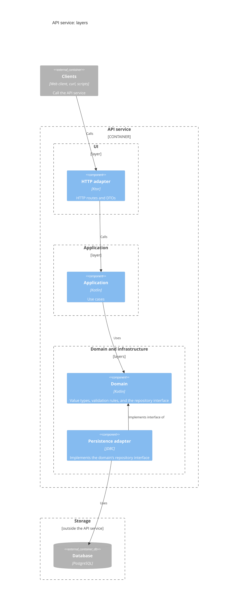

# API service components

The API service is a Kotlin application built on Ktor. Its code is arranged in
the four layers of domain-driven design (UI, application, domain, and
infrastructure), with dependencies pointing inward, toward the domain. The
layers are packages in one Gradle module, and the dependency rule is enforced
by convention and code review.

The application layer holds `ShortUrlService`, which implements all the use
cases of this service: shorten, resolve, delete, and list short URLs.

Adapters sit at the edge. The HTTP adapter turns requests into service calls
and results into responses. The persistence adapter runs SQL against
PostgreSQL through a HikariCP pool.

The composition root, `Application.kt`, is the only place that knows about
every layer. It reads configuration, constructs the components, and wires them
together by hand.

| Package             | Layer          | Holds                                                                                    |
| ------------------- | -------------- | ---------------------------------------------------------------------------------------- |
| `ui`                | UI             | The HTTP adapter: routes, problem details, and request IDs.                              |
| `app`               | Application    | `ShortUrlService`, which implements the use cases.                                       |
| `domain`            | Domain         | Value types, business rules, and the repository interface. See: concepts > domain model. |
| `infra.config`      | Infrastructure | Settings, read from the environment. See: concepts > configuration.                      |
| `infra.persistence` | Infrastructure | The connection pool, migrations, and the JDBC repository.                                |
