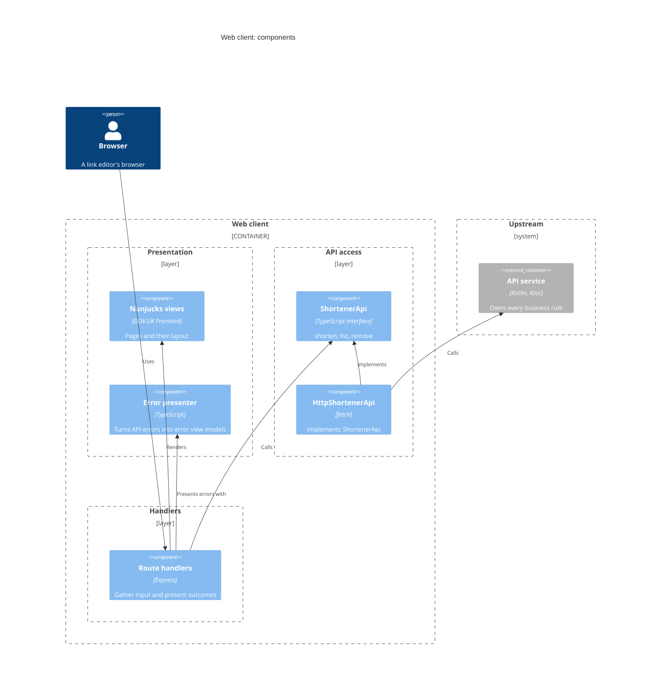

# Web client components

The web client is an Express application in TypeScript. It has no business
rules. It merely gathers input, calls the API service, and presents the outcome.
It doesn't duplicate the API service's validation, so the rules exist in one
place.

Route handlers handle form posts and page loads. Each handler branches on the
API client's result (`ok`, `rejected`, or `unavailable`). Pages are rendered
from Nunjucks views built with GOV.UK Frontend macros.

The home page, `GET /`, holds the shorten form, which posts to `POST /links`.
A successful post redirects to `/?created=<alias>`, and the home page looks
that alias up through the API service to show its short URL. It doesn't take
the short URL from the query, so a crafted link can't make the page show a
URL the system didn't make.

Below the form, the home page lists every short URL in a table, in the order
`GET /urls` returns them, newest first. Each row has a delete button, in a
form of its own that posts to `POST /links/<alias>/delete`. A successful
delete redirects to `/?deleted=<alias>`.

Every short URL link opens in a new tab. Each link carries visually hidden text,
"(opens in new tab)", for screen readers, following GOV.UK guidance.

The layout is GOV.UK Frontend's page template, with its own service
navigation in place of the GOV.UK header and footer. The web client serves
GOV.UK Frontend's compiled CSS and JavaScript, but none of its fonts or
images, and drops the CSS rules that load the font
([ADR 0008](../../decisions/0008/)).

Handlers depend on the `ShortenerApi` interface, not on `fetch`, so they can be
tested against a fake. `HttpShortenerApi` is the production implementation. It
calls the API service over HTTP with a per-call timeout, and parses
problem-details error responses.
