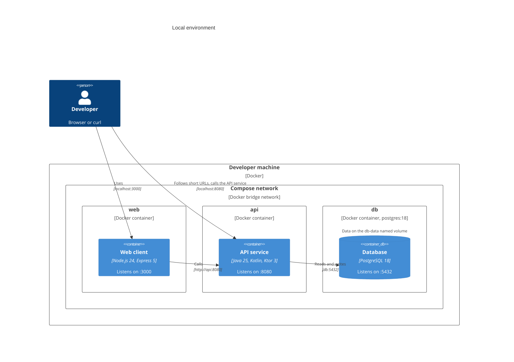
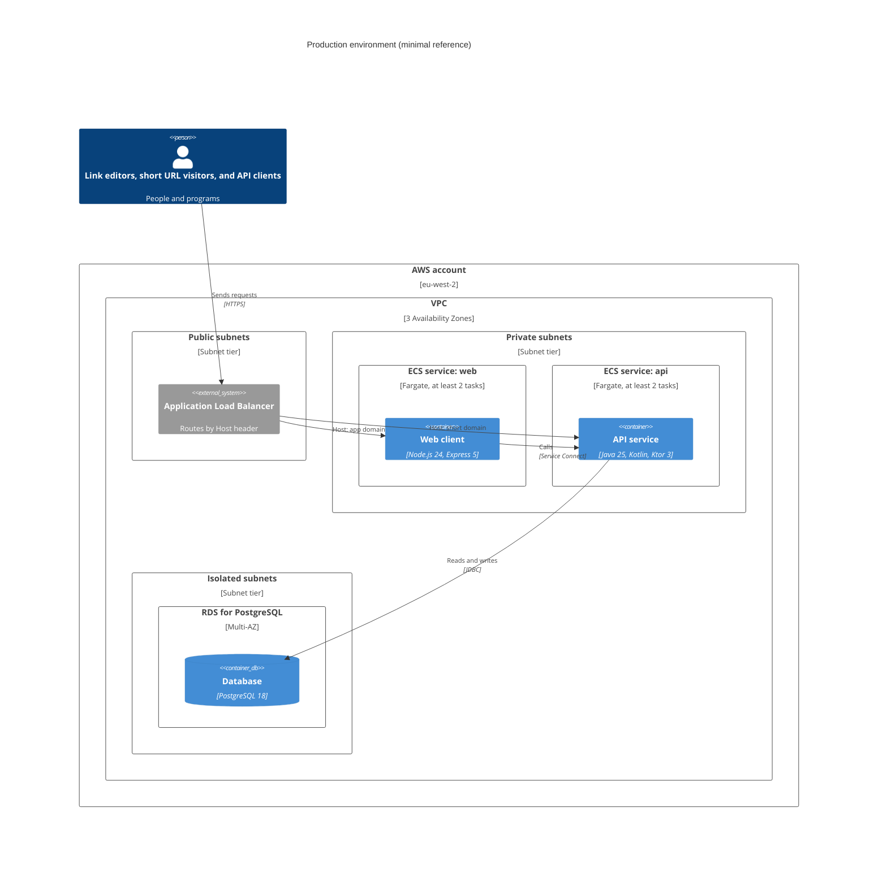

# Physical view

This architectural view describes where the system runs: the environments, the
infrastructure in each, and the network boundaries.

This view is for anyone running the system locally, or reasoning about it in
production. The [process view](../process/) describes what is running in each
deployed container.

There are two environments:

- **Local**, which runs entirely in Docker Compose from `compose.yaml`. This is
  the environment this repository actually builds and runs.

- **Production**, a reference deployment on AWS. This repository doesn't
  provision it. A separate Terraform repository would. It's documented here as
  the target the images and configuration are designed for.

The same two images run in both. Only environment variables differ.

## Local

**Developer machines** require only Docker. No JDK or Node.js runtime is
needed to run the system on the host machine.

The local system consists of three Docker Compose services: `web` and `api` are
built from `./src/web-client` and `./src/api-service` respectively; `db` is the
official `postgres:18` image.

Theres's a named Docker volume holding PostgreSQL's data directory. It survives
container restarts and `docker compose down`.

| Service | Reachable at                             | Notes                                     |
| ------- | ---------------------------------------- | ----------------------------------------- |
| `web`   | `http://localhost:3000`                  | The web client.                             |
| `api`   | `http://localhost:8080`                  | The API service, and the prefix of every short URL. |
| `db`    | Not published                            | Data is on the `db-data` named volume.    |

`web` reaches the API service at `http://api:8080` on the Compose network. The
API service builds short URLs with `PUBLIC_BASE_URL=http://localhost:8080`, the
address the browser of a link editor or short URL visitor can reach.

## Production

> [!IMPORTANT]
> The production environment is not implemented at this time. It is documented
> here as a reference for the target production infrastructure.

This is a minimal deployment design for production, on AWS. It shows only the
infrastructure the system cannot run without. Edge protection (CDN, WAF, DNS),
observability, secrets management, and the delivery pipeline are out of scope
here.

Two public hostnames are needed. The short domain (eg. `sho.rt`) serves the API
service. The app domain (eg. `app.sho.rt`) serves the web client.

The load balancer is the only component with a public address. It routes by
`Host` header to the `web` or `api` service. Health checks can be configured
here.

The `web` and `api` images run as ECS Fargate services, with at least two tasks
each, spread across three Availability Zones. `web` calls `api` through ECS
Service Connect, inside the VPC.

The database is RDS for PostgreSQL, with a synchronous standby in another
Availability Zone, automated backups, point-in-time recovery, and encryption at
rest. It sits in isolated subnets that have no route to the internet.

Sizing, network CIDRs, and IAM policies belong in the infrastructure repository
— out-of-scope for this repository.
