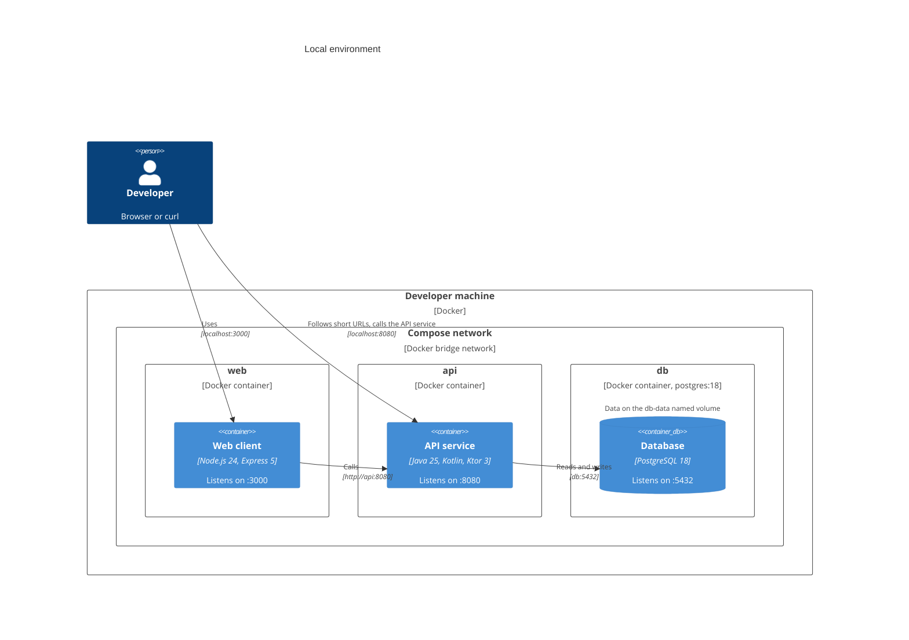

# Physical view

This architectural view describes where the system runs: the environments, the
infrastructure in each, and the network boundaries.

This view is for anyone running the system locally. The [process view](../process/) describes what is running in each
deployed container.

There is one environment: **local**, which runs entirely in Docker Compose from
`compose.yaml`. This is the environment this repository actually builds and
runs.

A production environment on AWS is proposed, but not implemented. Its design is
being thrashed out in [ADR 0021](../../decisions/0021/), and will move into this
view once it is built.

## Local

**Developer machines** require only Docker. No JDK or Node.js runtime is
needed to run the system on the host machine.

The local system consists of three Docker Compose services: `web` and `api` are
built from `./src/web-client` and `./src/api-service` respectively; `db` is the
official `postgres:18` image.

There's a named Docker volume holding PostgreSQL's data directory. It survives
container restarts and `docker compose down`.

| Service | Reachable at                             | Notes                                     |
| ------- | ---------------------------------------- | ----------------------------------------- |
| `web`   | `http://localhost:3000`                  | The web client.                             |
| `api`   | `http://localhost:8080`                  | The API service, and the prefix of every short URL. |
| `db`    | Not published                            | Data is on the `db-data` named volume.    |

`web` reaches the API service at `http://api:8080` on the Compose network. The
API service builds short URLs with `PUBLIC_BASE_URL=http://localhost:8080`, the
address the browser of a link editor or short URL visitor can reach.

The host ports can be changed with `WEB_PORT` and `API_PORT`, and
`PUBLIC_BASE_URL` follows `API_PORT`. Inside the Compose network, the ports
never change.

`make acceptance` runs a second copy of the system, as its own Compose project
with its own volume, published on `localhost:3001` and `localhost:8081`
([ADR 0025](../../decisions/0025/)). It can run alongside the system started
with `make up`, and it's removed when the run ends.
