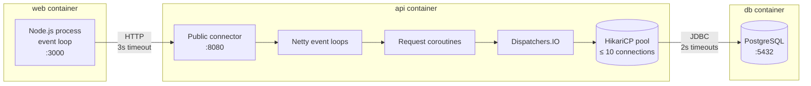

# Process view

This architectural view describes how the system behaves at runtime: which
processes run, what they listen on, how they handle concurrent requests, how
they talk to each other, and how they start and stop.

This view is for anyone operating, debugging, or load-testing the system.

## Overview

There are three long-running processes. Each runs in its own container.

| Process   | Runtime        | Ports                                   | State                  |
| --------- | -------------- | --------------------------------------- | ---------------------- |
| `web`     | Node.js 24     | `3000` (HTTP)                           | None                   |
| `api`     | JVM (Java 25)  | `8080`                                  | None (pool only)       |
| `db`      | PostgreSQL 18  | `5432`                                  | All persistent data    |

`web` and `api` hold no state between requests, so any number of instances
can run behind a load balancer, and any of those instances could be killed at
any time.

## Communication

| From      | To    | Protocol                                   | Timeout                                  | Retries |
| --------- | ----- | ------------------------------------------ | ---------------------------------------- | ------- |
| Browser   | `web` | HTTP, HTML forms (`POST`), `303` redirects | Browser default                          | None    |
| Browser   | `api` | HTTP `GET /{alias}`, `302`                 | Browser default                          | None    |
| `web`     | `api` | HTTP/1.1, JSON, keep-alive                 | 3s per call                              | None    |
| `api`     | `db`  | PostgreSQL wire protocol, via JDBC         | 2s to get a connection, 2s per statement | None    |

The two redirect codes serve different use cases:

- **Creating or deleting a short URL (Browser → `web`).** After the form
  `POST`, `web` replies `303 See Other` with a `Location` back to the home page
  (`/?created=my-alias` or `/?deleted=my-alias`), so the browser follows up with
  a `GET` (the Post/Redirect/Get pattern). A refresh then repeats the `GET`
  instead of resubmitting the form. Unlike `302`, a `303` always switches the
  method to `GET`.

- **Following a short URL (Browser → `api`).** `GET /{alias}` replies `302`
  with the target in `Location`. The request is already a `GET`, so the method
  doesn't matter. The redirect is temporary, so browsers don't cache it as they
  would a `301`.

The web client never retries API service calls. `POST /shorten` isn't currently
idempotent. Until it is, retrying this endpoint could result in duplicate aliases
for the same destination URL.

## Concurrency

- **`web`** runs one Node.js process per container, with a single-threaded
  event loop. All its work is I/O (calls to the API service), so one process handles
  many concurrent requests. It scales by adding containers, not by
  clustering inside one.

- **`api`** runs Ktor on the Netty engine. Requests are handled in Kotlin
  coroutines. Every database call switches to `Dispatchers.IO`, so blocking
  JDBC never stalls Netty's event-loop threads. The HikariCP pool (default 10
  connections) is the concurrency limit on database work. Requests beyond it
  wait for a connection, for up to 2 seconds.

**Alias races:** Two concurrent creates with the same alias are resolved by
the primary key and `INSERT … ON CONFLICT DO NOTHING`. Exactly one gets
`201`, and the other gets `400 alias-taken`. There's no application-level
locking.

## Startup

Each process validates its configuration before it does anything else, and
exits with status 1 if that fails. The startup sequences differ in how they
treat their dependencies: `api` needs the database before it can serve
traffic, whereas `web` doesn't depend on the API service being up.

**`api`:**

1. Read and validate configuration. Exit with status 1 if anything is
   missing or invalid.
2. Run Flyway migrations, over a connection of Flyway's own, so they aren't
   bound by the pool's statement timeout. Exit with status 1 on failure.
3. Create the HikariCP pool. Exit with status 1 if the database can't be
   reached.
4. Construct the service graph, and install the Ktor plugins and routes.
5. Start the public connector.

Flyway runs on every API service start, but it only does work when there's a new
migration. Concurrent starts are serialised by Flyway's lock.

**`web`:**

1. Read and validate configuration. Exit with status 1 on failure.
2. Build the app, and start listening.
   The web client doesn't wait for the API service, and it starts even if the
   API service is down.

In Compose, `api` starts only once `db` is healthy, and `web` once `api` has
started. This ordering is a convenience for local development, so the first page
load doesn't hit a "service unavailable" error. `web` doesn't rely on it, and
the production design doesn't enforce any such ordering.

## Shutdown

Both processes handle `SIGTERM` gracefully:

- **`api`:** Ktor's shutdown hook stops accepting connections, gives in-flight
  requests up to 10 seconds to finish, then closes the connection pool. It
  stops once there's been no activity for 2 seconds, the longest a request can
  wait on the database, so an idle instance stops in about 2 seconds.

- **`web`:** `server.close()` stops accepting connections, idle keep-alive
  connections are closed, and in-flight requests get up to 10 seconds to
  finish before the process exits.

The orchestrator's stop timeout (Compose's default of 10 seconds, or ECS's
`stopTimeout`) must be at least as long as these grace periods.
