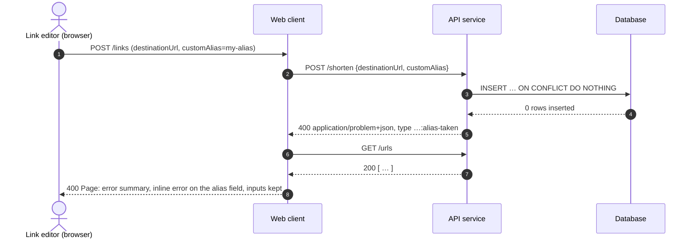

# S2: Submit an alias that's already taken

The same flow, without the database step, applies to any validation failure
(B3). The API service returns `validation-failed` with one entry per bad field, and the
web client shows each one against its field.
