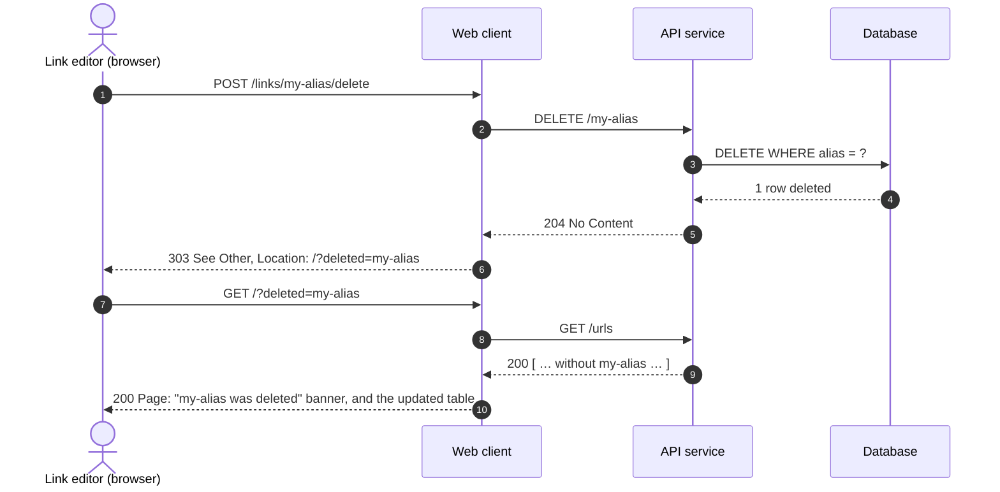

# S5: Delete a short URL, in the browser

If the API service returns `404` (someone else deleted the link first), the web client
treats the outcome as the one the link editor wanted, and shows the same banner.
