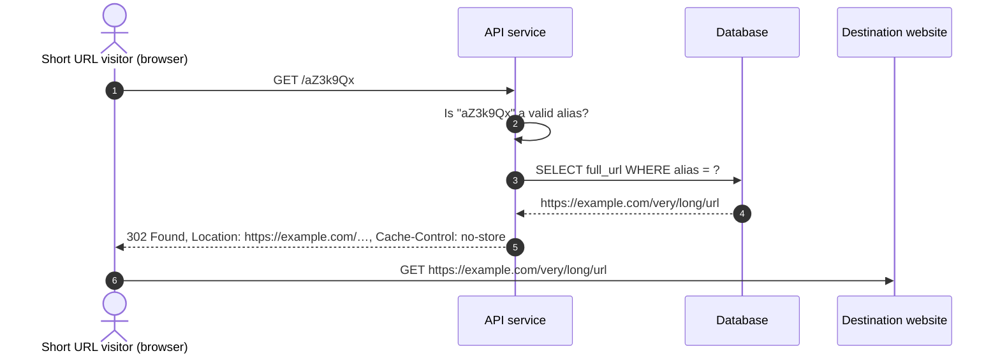

# S4: Follow a short URL

If the path segment isn't a valid alias, the API service returns `404` without
querying the database. If no row matches, it returns `404`, as an HTML page
for browsers and problem details for everything else
([ADR 0014](../../decisions/0014/)).
