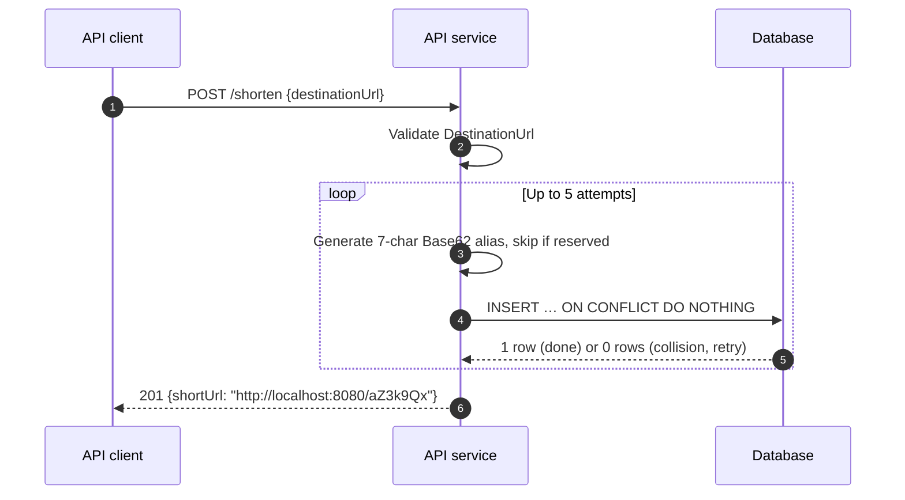

# S3: Shorten a URL with a random alias, via the API service

A collision is vanishingly rare ([ADR 0010](../../decisions/0010/)).
If all five attempts collide, the API service returns `500 internal-error`, and logs it.
