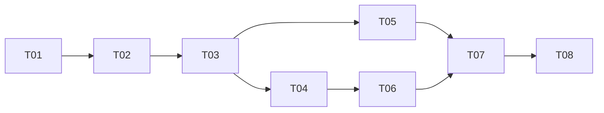

# URL shortener MVP - high level delivery plan

- Authors: Kieran Potts [@kieranpotts]
- Created: 2026-10-20
- Last updated: 2026-10-22
- Plan PR: —

## Status

IN PROGRESS

## References

- Implements: [requirements specification](../../specs/), B1 to B16, R1 to
  R11, and Q1 to Q7.

- Informed by: the accepted architectural decisions,
  [ADR 0001](../../decisions/0001/) to [ADR 0018](../../decisions/0018/), and
  [ADR 0025](../../decisions/0025/).

- Targets design: [`docs/design/`](../../design/), and the
  [repository layout](../../development/structure.md).

## Out-of-scope

- Everything in the proposed decisions, [ADR 0019](../../decisions/0019/) to
  [ADR 0024](../../decisions/0024/), and [ADR 0026](../../decisions/0026/).

- Pagination of `GET /urls`, authentication, and link ownership. Each needs a
  change to the specification first.

## Approach

**Walking skeleton first.** The riskiest part of the project is the toolchain
and wiring, not the features: two build systems, three test packages, test
suites that live outside the apps they test, Testcontainers inside a
devcontainer, and Playwright against Compose. The first increment proves all
of it end to end, around placeholder apps, so every later increment is
ordinary feature work.

**Then vertical slices, one behavior at a time.** Each later increment
delivers a small set of requirements whole: code, tests at every relevant
level, and acceptance tests named after the requirement IDs. The API service
leads, and each web client increment follows once the endpoints it calls
exist, so its acceptance tests run against the real system.

**Every increment is shippable.** Each lands as one pull request. At the end
of every increment, `docker compose up --build` runs the system, and
`make check` passes. No increment relies on
work scheduled after it.

**Every increment updates the changelog.** Before an increment is marked
done, its notable changes are added to the `[Unreleased]` section of the
[changelog](../../../CHANGELOG.md), in the same pull request.

**Details are settled in implementation.** The design docs and ADRs say what
to build. Where implementation shows them to be wrong or incomplete, the
increment that finds out corrects the docs in the same pull request.

## Task breakdown

This plan tracks the status of each increment. There is no separate issue
tracker.

| ID  | Increment                                      | Delivers                     | Status    | Depends on |
| --- | ---------------------------------------------- | ---------------------------- | --------- | ---------- |
| T01 | Walking skeleton                               | Q4, Q5, Q6                   | ✅ DONE   | —          |
| T02 | API service foundations, and the contract      | B14, Q1, Q2                  | ✅ DONE   | T01        |
| T03 | Shorten URLs through the API                   | B1 to B4, B12, B13, R1 to R8 | ✅ DONE   | T02        |
| T04 | Follow short URLs                              | B5, B8, B15, Q7              | ✅ DONE   | T03        |
| T05 | Shorten URLs from the web client               | B9, B11, Q3                  | ✅ DONE   | T03        |
| T06 | List and delete short URLs through the API     | B6, B7, R9 to R11            | ✅ DONE   | T04        |
| T07 | List and delete short URLs from the web client | B10, B16                     | ✅ DONE   | T05, T06   |
| T08 | Documentation and release                      | —                            | ⭕ TODO   | T07        |

### Increments

- **T01 — Walking skeleton.** The devcontainer, with the JDK, Node.js, and
  access to Docker. The API service's Gradle build, with its unit and
  integration suites sourced from `tests/api-service/`. The web client and its
  test package, and the acceptance test package. Linters and formatters for
  both languages. Both `Dockerfile`s, and `compose.yaml` with `db`, `api`, and
  `web`. The `run/` scripts and `Makefile` targets. Each app serves only a
  placeholder page. Done when every `make` target works, and one placeholder
  test passes at each test level, including a Testcontainers database test
  and a Playwright smoke test against Compose.

- **T02 — API service foundations, and the contract.** The
  [configuration](../../design/concepts/configuration.md),
  [error handling](../../design/concepts/error-handling.md) (problem details
  and `X-Request-Id`), graceful shutdown, the database connection pool, and
  migrations at startup. The HTTP test harness, which validates every
  response against the contract. `GET /openapi.yaml` is the first real
  behavior, and proves the harness, the image, and the acceptance suite.

- **T03 — Shorten URLs through the API.** The
  [domain model](../../design/concepts/domain-model.md), with the alias and
  destination URL rules. The schema and repository for short URLs.
  `POST /shorten`, with random and custom aliases, validation, alias
  conflicts, and the `415` and `413` checks. Hostile-input tests show that no
  input causes a `5xx`. Unit tests show that the random alias generator draws
  from a cryptographically secure source, as [ADR 0010](../../decisions/0010/)
  requires, so aliases can't be predicted from earlier ones. Tests with an
  injected generator that returns a duplicate first show that a collision is
  retried and succeeds, and that five consecutive collisions end in the
  documented failure, not a hang.

- **T04 — Follow short URLs.** `GET /{alias}` redirects, and `404`s for
  unknown and invalid aliases. Tests that restart the API service and its
  database, and show that every alias survives. Fill in the R7 acceptance
  test, `tests/acceptance/stored-as-given.spec.ts`, which T03 left as a
  `test.fixme` placeholder because nothing could observe a stored destination
  URL before redirects existed. A test that stops the database and shows that
  a redirect fails cleanly, with a problem details `503` and no stack trace or
  hang, and that redirects resume when the database returns.

- **T05 — Shorten URLs from the web client.** The web client's
  configuration, security headers, GOV.UK Frontend layout, and its client for
  the API service. The shorten form, the result shown after a successful
  submission, and error messages that keep the link editor's input, both when
  the API service rejects the request and when it can't be reached.

- **T06 — List and delete short URLs through the API.** `GET /urls`, newest
  first, and `DELETE /{alias}`. Tests show that a deleted alias stops
  redirecting, and can be created again straight away.

- **T07 — List and delete short URLs from the web client.** The table of
  short URLs on the home page, and a delete button on each row.

- **T08 — Documentation and release.** Rewrite the README: prerequisites, how
  to run and test the system, example requests, notes and assumptions, links
  to the docs, and time spent. Fill in the developer docs that are still
  templates. Correct any design doc the implementation has drifted from.
  Review the whole codebase for `TODO` comments and either resolve each one
  or turn it into a documented follow-up. In the README's notes and
  assumptions, state the scale the MVP is designed for (a single PostgreSQL
  instance, which is ample below about 100 million links), and list what it
  deliberately omits: redirect caching, distributed ID generation, and a CDN.
  Each omission names the metric that would justify adding it, and links to
  [ADR 0021](../../decisions/0021/). Verify everything from a clean clone, tag
  a versioned release, and submit. See the [T08 steps](#t08-steps).

### T08 steps

T08 is mostly documentation, so it's broken into smaller steps. Each one is
a commit, or a few, on the trunk. Code changes come first, so the README
describes the final code. The release comes last.

| ID    | Step                                   | Status | Depends on     |
| ----- | -------------------------------------- | ------ | -------------- |
| T08.1 | Resolve the `TODO` comments            | ✅ DONE | —              |
| T08.2 | Correct documentation drift            | ✅ DONE | T08.1          |
| T08.3 | README: run and test the system        | ⭕ TODO | T08.2          |
| T08.4 | README: example requests               | ⭕ TODO | T08.3          |
| T08.5 | README: notes, assumptions, and limits | ⭕ TODO | T08.2          |
| T08.6 | README: debrief and time spent         | ⭕ TODO | T08.3 to T08.5 |
| T08.7 | Verify from a clean clone              | ⭕ TODO | T08.6          |
| T08.8 | Tag the release, and submit            | ⭕ TODO | T08.7          |

- **T08.1 — Resolve the `TODO` comments.** There are two in code:
  - `Alias.kt` — the reserved words. Either move them into the API
    service's [configuration](../../design/concepts/configuration.md), or
    keep them in code and record why. They're part of the alias rules in
    [ADR 0009](../../decisions/0009/), and changing them at deploy time
    could invalidate aliases already stored, so keeping them in code is the
    likely outcome. Either way, the comment goes.
  - `http-shortener-api.ts` — extract the JSON and type-guard helpers into
    a shared module, with their own unit tests, if a second caller needs
    them. Otherwise, delete the comment.

  Anything deferred becomes a follow-up in the README's notes (T08.5), not
  a comment. Done when a search for `TODO` outside lock files and this plan
  finds only the README's time-spent marker, which T08.6 removes.

- **T08.2 — Correct documentation drift.** Read each design view, and the
  developer docs, against the code as it stands, and fix what's wrong. Known
  drift:
  - This plan's references say ADRs 0001 to 0018 are accepted, and 0019 to
    0023 proposed. [ADR 0024](../../decisions/0024/) (proposed) and
    [ADR 0025](../../decisions/0025/) (accepted) have been added since.
  - The README says the plan has nine tasks, T01 to T09. It has eight.

  Also check that every spec's "Verified by" link points to an acceptance
  test that exists, that every relative link in `docs/` resolves, and that
  no developer doc is still a template. Done when none of the docs describe
  behavior the code doesn't have.

- **T08.3 — README: run and test the system.** Prerequisites (Docker, or
  the devcontainer), `docker compose up --build`, the ports and URLs of the
  web client and API service, `make check` and the narrower `make` targets,
  and how to stop and reset. Keep it short, and link to the
  [onboarding guide](../../development/onboard.md) for detail, rather than
  repeating it. This is the README content that Q4 and Q5 rely on.

- **T08.4 — README: example requests.** `curl` examples for each endpoint:
  `POST /shorten` with a random alias and a custom one, `GET /{alias}`,
  `GET /urls`, `DELETE /{alias}`, `GET /openapi.yaml`, and one rejected
  request showing a problem details response. Run every example against
  `make up`, and paste the real responses, trimmed.

- **T08.5 — README: notes, assumptions, and limits.** The assumptions made
  where the brief was silent, linking to the spec and ADRs rather than
  restating them. The scale the MVP is designed for: a single PostgreSQL
  instance, which is ample below about 100 million links. What it
  deliberately omits — redirect caching, distributed ID generation, and a
  CDN — each with the metric that would justify adding it, linking to
  [ADR 0012](../../decisions/0012/) and [ADR 0021](../../decisions/0021/).
  What's out of scope: pagination of `GET /urls`, authentication, link
  ownership, the proposed ADRs (including automated accessibility tests,
  [ADR 0026](../../decisions/0026/)), and any follow-ups from T08.1.

- **T08.6 — README: debrief and time spent.** Tidy the debriefing notes
  into their final form, fix typos, record the final development time, and
  remove its `TODO` marker. Read the README top to bottom as a reviewer
  would, and cut anything the linked docs already say.

- **T08.7 — Verify from a clean clone.** Clone the repository into an
  empty directory, and follow the README literally, on a host with only
  Docker: `docker compose up --build`, then each example request. Then, in
  the devcontainer, run `make install` and `make check`. Fix anything that
  fails, in the README or the code, and repeat until a clean clone passes
  with no steps the README doesn't mention.

- **T08.8 — Tag the release, and submit.** Add T08's changes to the
  `[Unreleased]` section of the changelog. Mark T08 and this plan as done,
  and commit, because `make version` needs a clean working tree. Run
  `make version` to tag `v1.0.0`, push the commit and tag with
  `git push --follow-tags`, and submit the repository link.

## Dependency graph

## Open questions

None.
